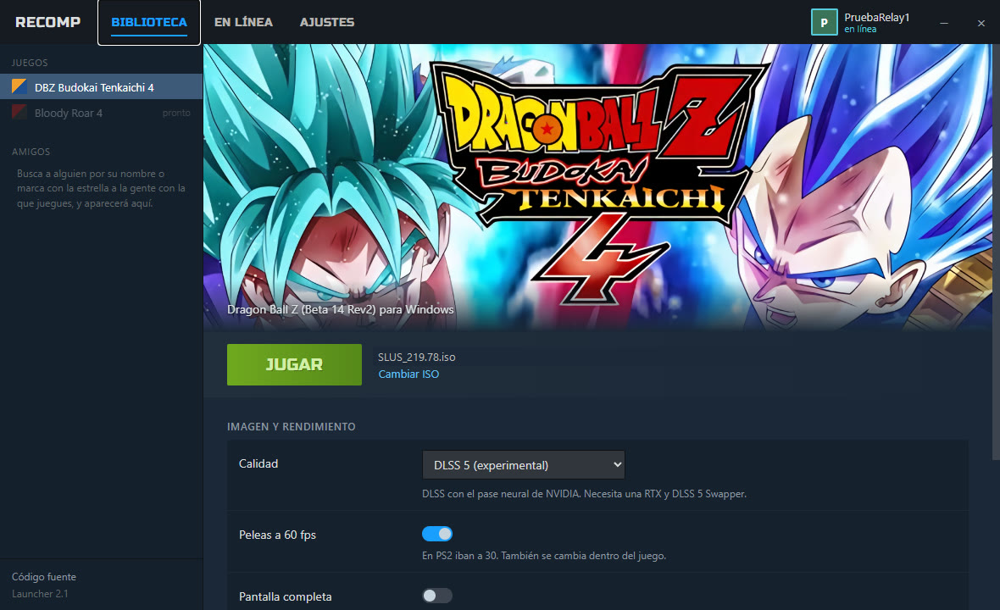
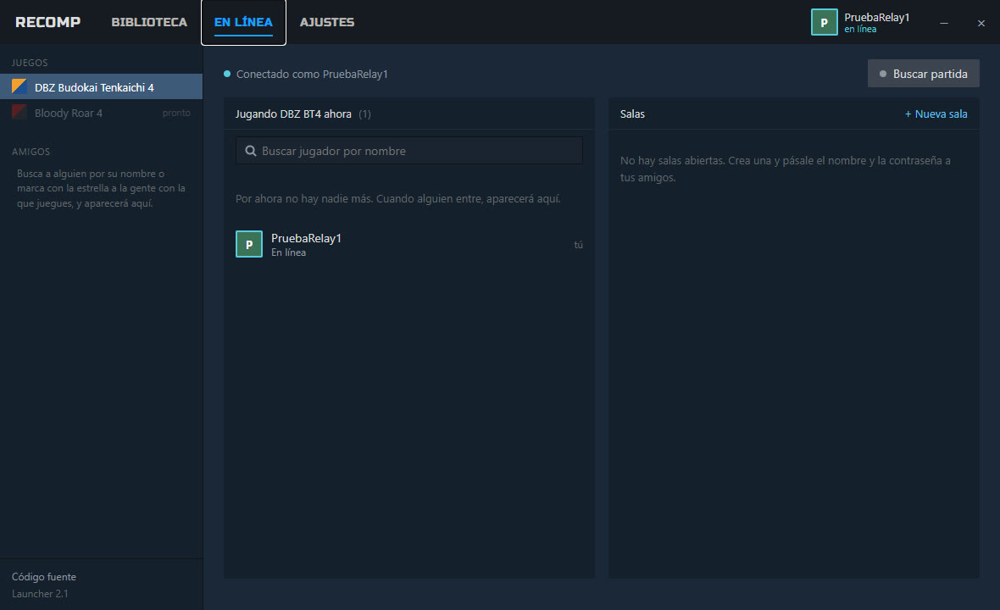
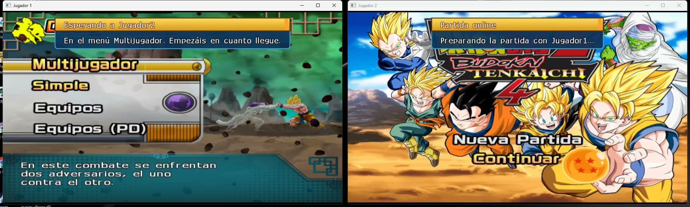
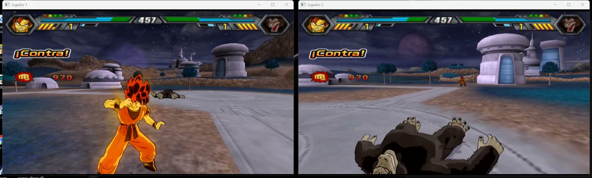

# DBZ Budokai Tenkaichi 4 — PS2Recomp

*Dragon Ball Z: Budokai Tenkaichi 4*, the [Team BT4](https://teambt4.wixsite.com/teambt4projects) fan mod of BT3
(disc `SLUS-219.78`, "Beta 14 Rev2"), statically recompiled to run natively on **Windows**, **Mac** and **Android**, with online play.

| | |
| --- | --- |
|  |  |
|  |  |
|  |  |

*Screenshots from an earlier Windows build (PCSX2's GS renderer at 6x, RTX 4090). Both systems now draw the game with
its own native renderer (see Features).*

https://github.com/user-attachments/assets/f0d626ea-ad75-40a9-a4c0-8109d5d1ce4c

*65 s of highlights (720p60; GitHub only plays videos up to 10 MB inline).*
**[▶ Full video, 4:22](docs/videos/dbz_bt4_mod.mp4)**: the mod's new characters (Super Saiyan Blue, Beerus, Goku Black,
Zamas, Jiren, Hit, Caulifla, Kale...) and stages (Tournament of Power, Champa's ring...).

## Features

- **Native on Windows, Mac (Apple Silicon) and Android**: ready-to-play zips and an APK, each with the launcher. No
  emulator to set up.
- **Android**: the same game and launcher on a phone, in portrait, with touch controls (or a Bluetooth controller).
  Snapdragon GSR 2 upscaling on Adreno GPUs (FSR 2 on the others), 60 fps fights on high-end phones (POCO F8 Ultra:
  60 fps, 17.6 ms p95), resolution that adapts to load and heat. Android 12+, arm64, a 2022+ Vulkan driver.
- **Sharp graphics**: the game's own native renderer (Vulkan), with the game's real depth and motion fed
  to the upscaler: NVIDIA DLSS or AMD FSR 2 on Windows, Apple MetalFX on Mac at the screen's full (Retina) resolution.
  On Mac the shaders are prepared while the game starts, so effects don't stutter the first time they appear.
- **More frames on screen (Windows)**: **Más fps en pantalla** generates an in-between frame from the game's real
  motion, up to 120 on screen on monitors of 90 Hz or more, without speeding the game up.
- **60 fps fights**, switchable at any time, even mid-fight.
- **Online play**: accounts, friends, invitations, rooms of 2 to 4 players taking turns, with chat. Windows and Mac play
  together. No ports to open. Both games run the same frames (lockstep) and check each other as they go.
- **Online statistics**: fights won and lost, win rate, time played online and a table of the best players.
- **Everything unlocked** from the start (an option, on by default): every character, stage and mode.
- Controllers (Xbox, PlayStation, MFi) and keyboard; an in-game options menu (F1 or hold START).

## Download and play

| Windows 10/11 (64-bit, GPU with Vulkan) | Mac (Apple Silicon, macOS 14+) | Android 12+ (arm64, Vulkan 2022+) |
| --- | --- | --- |
| **[⬇ DBZ_BT4_Windows.zip](https://github.com/recomp-code/dbz-bt4-recomp/releases/latest/download/DBZ_BT4_Windows.zip)** | **[⬇ DBZ_BT4_Mac.zip](https://github.com/recomp-code/dbz-bt4-recomp/releases/latest/download/DBZ_BT4_Mac.zip)** | **[⬇ DBZ_BT4_Android.apk](https://github.com/recomp-code/dbz-bt4-recomp/releases/download/android-v3.4.7/DBZ_BT4_Android.apk)** |

1. **Unzip it.**
   - Windows: into a folder you can write to (Desktop, Documents; not Program Files).
   - Mac: drag `DBZ_BT4.app` to Applications. It isn't signed with an Apple developer account, so open it the first
     time like this. macOS 15: double-click, **Done**, then System Settings > Privacy & Security > **Open Anyway**.
     macOS 14: right-click > **Open**.
2. **Open the launcher** (`DBZ_BT4.exe` / `DBZ_BT4.app`), press **Seleccionar ISO** and pick your own image of the mod
   (`SLUS-219.78`, Beta 14 Rev2). Only the first time. Other versions of the mod don't work: the game was recompiled
   for this one.
3. **Press JUGAR.** It starts with 60 fps fights and fullscreen. Change them in the launcher; it remembers them. The
   launcher updates itself and the game when a new version comes out.

| | |
| --- | --- |
|  |  |

**Android**: install the APK (allow installs from that source when Android asks), open it, **Seleccionar ISO** (your
image is read in place, never copied) and **JUGAR**. On-screen touch controls; a Bluetooth controller hides them. The
whole game in landscape, the launcher in portrait:

More in [android/README.md](android/README.md).

The zips have **no game data**: the launcher reads what it needs from your ISO. Get the mod and its updates from
**[Team BT4's download page](https://teambt4.wixsite.com/teambt4projects/descarga)**.

## Play online

1. In the launcher, tab **EN LÍNEA**: create an account or sign in. Your session stays saved, encrypted; your password
   is never stored.
2. You see who is online. To start a match:
   - press **Invitar** on someone;
   - turn on **Buscar partida** so others see you want to play;
   - or create a **room** (with a password if you like).

   **Buscar jugador por nombre** finds anyone, and the star adds them to your friends.
3. When the invitation is accepted, both games open and meet at the game's **Multijugador** menu. Player 1 picks the
   battle type, and both go to character select together.
4. During the match, **Back + Start** (or **Shift+Tab**) brings the launcher over the game: invitations, the room's
   chat, **Salir de la partida online**.
5. **Estadísticas** (top of EN LÍNEA) shows your wins, losses, win rate, time played and place, and the table of the
   best players. A fight only counts when both players' games saw the same result.

Both players need the same release (the launcher tells you otherwise). **Android** plays online with Android now, and
with Windows and Mac from their next release (they need the same deterministic math, online protocol `net3`). If the fight stutters because you're far
apart, raise **Retraso de controles** in AJUSTES.

| | |
| --- | --- |
|  |  |

## Controls

- **Controller**: works as on the PS2 (Xbox: A = Cross, B = Circle, X = Square, Y = Triangle).
- **Keyboard**:
  - arrows = d-pad, WASD = left stick;
  - Z / X / C / V = Square / Cross / Circle / Triangle;
  - Q / E = L1 / R1, 1 / 3 = L2 / R2;
  - Enter = START, Backspace = SELECT.
- **F1** or **hold START 1.5 s**: options (60 fps fights, FPS counter...).
- **Fullscreen**: Alt+Enter (Windows) or Option+Return / Ctrl+Cmd+F (Mac).
- The mod's unlock code also works on the main menu: hold L1+R1 and press Down, Right, Triangle, Down, Left, Triangle, Up.

## Building from source

This repository contains no game data or game code: building generates the code from your own ELF. The steps, the
patches on top of [z3xox/BT3-Recomp](https://github.com/z3xox/BT3-Recomp) and the repository layout are in
**[docs/BUILDING.md](docs/BUILDING.md)**. The launcher and the online server are
[recomp-code/recomp-online](https://github.com/recomp-code/recomp-online).

## Credits

- [Team BT4](https://teambt4.wixsite.com/teambt4projects) for the mod and its extras.
- [z3xox/BT3-Recomp](https://github.com/z3xox/BT3-Recomp), [PS2Recomp](https://github.com/ran-j/PS2Recomp),
  [PCSX2](https://github.com/PCSX2/pcsx2), [Play!](https://github.com/jpd002/Play-).

License: GPL-3.0 (see `LICENSE`).
