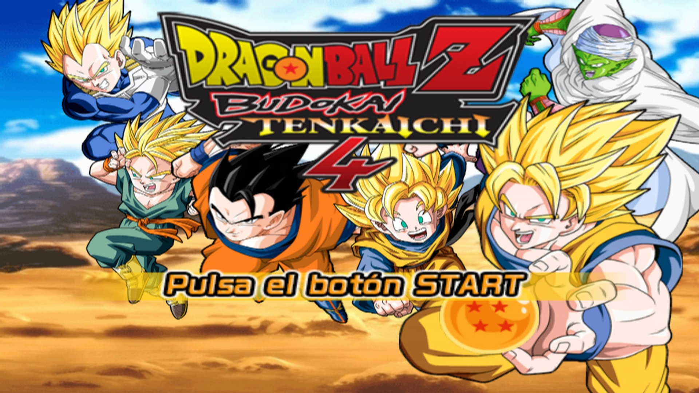
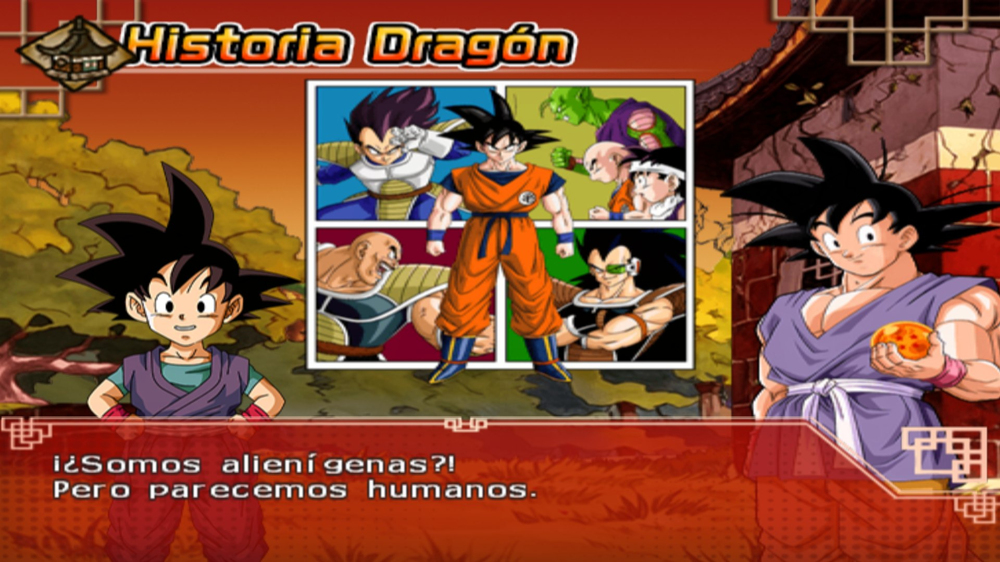
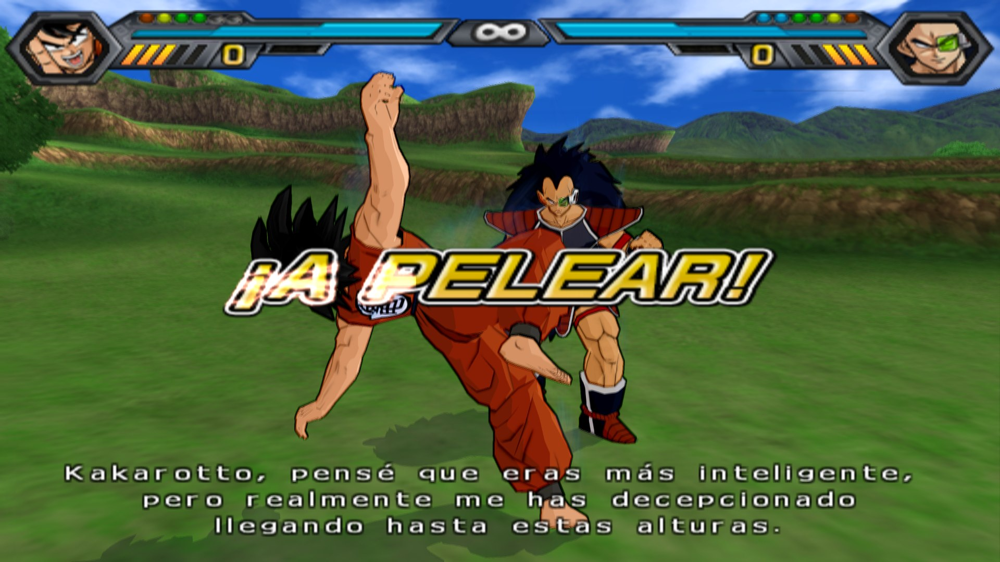
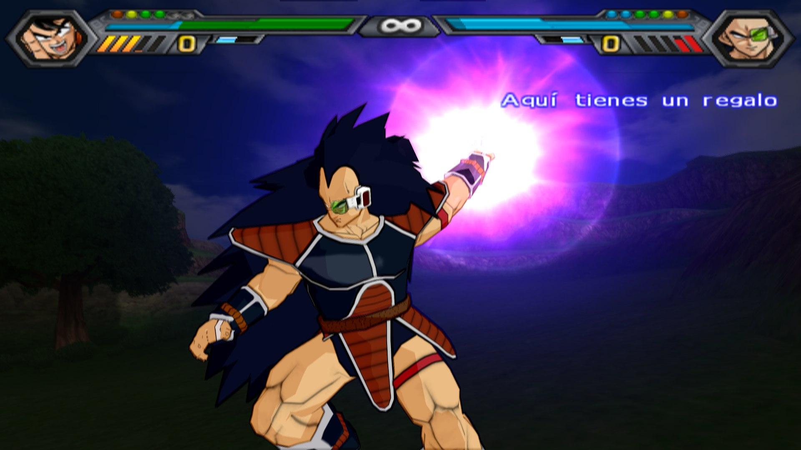
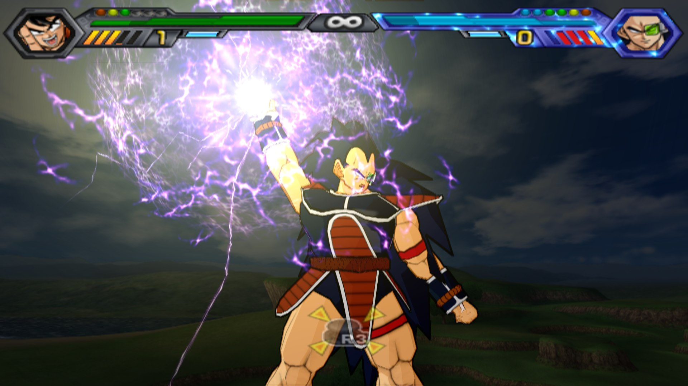
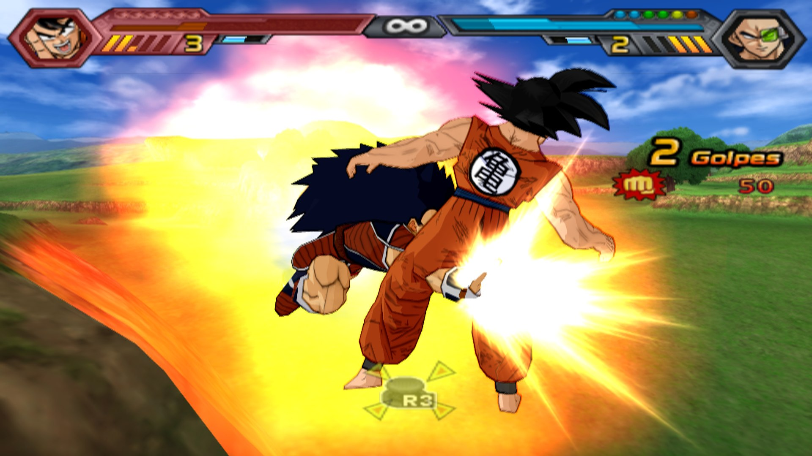

# DBZ Budokai Tenkaichi 4 (BT3 mod) — PS2Recomp

Static recompilation of *Dragon Ball Z: Budokai Tenkaichi 4* (the [Team BT4](https://teambt4.wixsite.com/teambt4projects)
fan mod of BT3, disc `SLUS-219.78`, "Beta 14 Rev2") with [PS2Recomp](https://github.com/ran-j/PS2Recomp). It runs on these targets:

| | |
| --- | --- |
|  |  |
|  |  |
|  |  |

*Native Windows build, PCSX2's GS on Vulkan at 6x, 1920x1080 window (RTX 4090).*

**[▶ Video: the mod's characters and stages, Jiren vs. Zamas (Fusion) at the Tournament of Power](docs/videos/dbz_bt4_mod.mp4)**
(native Windows build, 6x internal resolution, 2560x1440 at 60 fps, game audio; AV1). It enters the mod's unlock-all
code on the main menu (hold L1+R1, then Down, Right, Triangle, Down, Left, Triangle, Up: the seven Dragon Balls light up),
goes through the roster rows that BT3 never had (Super Saiyan Blue forms, Beerus, Broly SSJ3, Cell Max, Goku Black,
Zamas, Toppo, Jiren, Hit, Cabba, Caulifla, Kale...), the new stages (Tournament of Power, Champa's ring, Planet Tsufuru,
Red Ribbon base, Muscle Tower, Baba's palace, Space...) and fights on the Tournament of Power stage. Recorded unattended
with `windows/record_video.ps1` + `windows/mux_video.ps1`.

## Download and play (Windows, nothing to compile)

**[⬇ DBZ_BT4_Windows.zip](https://github.com/recomp-code/dbz-bt4-recomp/raw/main/download/DBZ_BT4_Windows.zip)** (92 MB)

1. Unzip it in a folder you can write to (Desktop, Documents, Downloads; not Program Files).
2. Open `DBZ_BT4.exe`, press **Seleccionar ISO...** and pick your own image of the mod: `SLUS-219.78`, Beta 14 Rev2.
   Only the first time. Another version of the mod does not work: the game was recompiled for that one (the launcher
   checks the ELF's SHA-256).
3. Pick the quality (6x native, 3x, or 2x + DLSS / FSR), 60 fps fights on or off, and press **JUGAR**.

Needs Windows 10/11 64-bit and a GPU with Vulkan (DLSS on NVIDIA RTX, FSR on the rest). Xbox-style controllers and the
keyboard work out of the box; F1 opens the graphics options. `DBZ_BT4.exe --jugar` starts straight away with the saved
options (for a desktop shortcut). The zip has the recompiled runner and PCSX2's GS host, **not the disc**: the launcher
copies the ELF and the IRX modules out of your ISO into `runtime\data\` and the game streams everything else from the ISO.
Built with `windows/make_dist.ps1`; the launcher's source is `windows/launcher/DBZ_BT4.cs` (`windows/build_launcher.ps1`,
the C# compiler that ships with Windows).

> **The mod is the work of Team BT4.** Get it, its updates and the PCSX2 extras (the `GameIndex.yaml` with the
> SLUS-21978 fixes) from their official page: **https://teambt4.wixsite.com/teambt4projects**
> ([download section](https://teambt4.wixsite.com/teambt4projects/descarga)).

- **Native Windows (playable)**: the same BT3-Recomp route, with PCSX2's GS on Vulkan (6x), NVIDIA DLSS (temporal, with
  motion vectors estimated on the GPU) or AMD FSR 1, fights at 30 or 60 fps. See [Native Windows](#native-windows).
- **Native macOS (recommended, playable)**: [z3xox/BT3-Recomp](https://github.com/z3xox/BT3-Recomp) adapted to the mod. By default the game is drawn by PCSX2's GS (`pcsx2-gsrunner`, Metal hardware renderer, 6x upscaling, Team BT4 hardware fixes) in its own window, at 30 fps in fights. The older route, paraLLEl-GS on MoltenVK with 2x supersampling, is still available (`DBZ_RENDERER=pgs`). Sound is correct. See `native/`, `patches/bt3recomp-bt4mod.patch` and `patches/bt3recomp-bt4mod-pcsx2gs.patch`.
- Native macOS, our own recompilation with PCSX2's GS (`pcsx2-gsrunner`): experimental.
- **Browser** (WebAssembly): the web runtime from [street-recomp-v3](https://github.com/recomp-code/street-recomp-v3) with Play!'s GS on WebGL2.

**This repository contains no game data.** Bring your own disc image. The sources and patches contain no game code
either: building generates it from your ELF. The one exception is the ready-to-play Windows zip in `download/`, whose
runner holds the game's code already recompiled from the Beta 14 Rev2 ELF (no ISO, ELF or disc files are in it).

## Status (2026-10-18)

- Boots through the Spike logo, intro FMV, title, memory card and menus, then character and stage select into fights.
- Browser: fights run at 60 fps with characters, HUD, specials and ki effects.
- Still to do:
  - **audio** is wrong: periodic stale chunks, mono output and extra content. The cause is localized in the EE-side CRI ring writes, probably another mistranslated instruction.
  - Some graphics glitches remain: white areas on some stages, block rectangles and flashes.
- Native macOS: work in progress.
- The "still to do" items above are the **browser** build's (our own PS2Recomp runtime + Play!'s GS). The native builds
  use BT3-Recomp's runtime, which does not have them.
- Native Windows (2026-10-19): playable end to end (Team BT4 splash, title, Dragon History, Duel with the whole unlocked
  roster, fights at 30 and 60 fps), with the fight-start fade drawn correctly (read-back answered by PCSX2) and DLSS/FSR.
  Audio: real stereo (a 264 s recording of menus and a fight: side/mid RMS 0.41, 3 mono seconds; `windows/wav_stats.py`).
  Graphics: no white areas or block rectangles seen on the stages visited so far (Wasteland, Tournament of Power); the
  remaining stages have not been checked one by one. BT3-Recomp's lockstep netplay (`PS2X_NET_LISTEN` / `PS2X_NET`)
  connects and stays in sync (0 desyncs over ~6400 frames between two instances on one PC); not tested between two PCs.

## Native Windows

The macOS route (BT3-Recomp + `patches/bt3recomp-bt4mod-full.patch` + PCSX2's GS in its own window) built with
clang-cl + Ninja, plus `patches/bt3recomp-bt4mod-windows.patch` (runtime) and `patches/pcsx2-gsrunner-dbz-windows.patch`
(host). The files in `windows/` assume the work folder `C:\DBZBT4Recomp` and the NBA Street V3 port's portable tools and
PCSX2 deps in `C:\NBAStreetRecomp` (LLVM 20, Ninja, CMake, MinGit; VS 2022 Build Tools for the SDK).

```bat
:: runtime
git clone https://github.com/z3xox/BT3-Recomp C:\DBZBT4Recomp\bt3mod && cd /d C:\DBZBT4Recomp\bt3mod && git checkout e22a34b
git apply --exclude=ps2xRuntime/third_party/parallel-gs ..\dbz-bt4-recomp\patches\bt3recomp-bt4mod-full.patch
git apply ..\dbz-bt4-recomp\patches\bt3recomp-bt4mod-windows.patch
python ..\dbz-bt4-recomp\windows\iso_extract.py <iso> extract games\bt3\work   &:: 7-Zip fails on the three big AFS files
set PS2X_SETUP_FORCE=1& set PS2X_SETUP_NO_SUBMODULES=1
python games\bt3\setup.py games\bt3\work\SLUS_219.78 --stages 3-3 --jobs 20 --no-deps --non-interactive --no-package
..\dbz-bt4-recomp\windows\reconfigure.cmd & ..\dbz-bt4-recomp\windows\build_runner.cmd   &:: GUI subsystem, llvm-rc
:: host: a copy of the NBA port's PCSX2 tree + patches\pcsx2-gsrunner-live-dbz.patch + patches\pcsx2-gsrunner-dbz-windows.patch
..\dbz-bt4-recomp\windows\build_pcsx2.cmd
:: then gshost\ = pcsx2-gsrunner.exe + the NBA gshost DLLs and resources\ (Team BT4's GameIndex.yaml) + nvngx_dlss.dll,
::               windows\gshost\dbz.ini and dbz_dlss.ini, and an empty portable.ini
```

Play with `windows\Jugar_DBZ.cmd` (30 fps), `Jugar_DBZ.cmd 60` / `Jugar_DBZ_60fps.cmd` (60 fps fights) or
`Jugar_DBZ_DLSS.cmd` (2x + DLSS); `set DBZ_WINDOW=1` for a window. F1 in the game window opens the GS options
(internal resolution, DLSS / FSR 1, sharpness). paraLLEl-GS is off on Windows (`PS2X_DISABLE_PGS=ON` by default), so the
Granite submodules are not needed.

What the Windows patches change:
- **Live ring on Windows** (`ps2_gs_live.cpp`, `ps2_live_ring.h`): the upstream ring was POSIX only (`shm_open`,
  `posix_spawn`). On Windows it is a named mapping plus named auto-reset events (`Local\PS2RecompGsLiveRing_<pid>`, `...Data`,
  `...Space` and, for version 2, `...Readback`), the protocol of the NBA Street V3 port; the host is started with
  `CreateProcessW` + `CREATE_NO_WINDOW`. Version 2 on Windows: the readback block (`RingReadback` seq/bytes + 8 MB) follows
  the data area directly, since the POSIX "events" words do not exist in the mapping. Version 1 rings are still accepted.
  `PS2X_GSLIVE_READBACK=0` restores the old behaviour.
- **Host** (`GSDumpReplayer.cpp`): ReadFIFO2 replies on Windows too (upstream had them under `#if !defined(_WIN32)`).
- **PSMCT24 transfers are 3 bytes per pixel** (`Support.h` `bytesForPixels`; it said "treat as 32"). The fight-start fade
  downloads a 512x224 PSMCT24 frame into a 344064-byte buffer; counted as 4 bytes per pixel, `sceGsExecStoreImage` wrote
  458752 bytes. Once the GS host answers the download with real pixels, the overrun lands on the next heap block's header and
  the game's pool walk (`FUN_00254fe0`, pc 0x255018) loops forever at the start of every fight. This one affects every
  platform; it only went unnoticed while the overrun was filled with zeros from the runtime's own VRAM.
- `PS2X_PAD_SCRIPT="12:START,15.5:LEFT,16:CROSS+SQUARE"` (+ `PS2X_PAD_SCRIPT_HOLD` ms): timed presses for unattended tests,
  seconds since process start, or since the game first reaches a state with `PS2X_PAD_SCRIPT_STATE=0x4` (main menu);
  `PS2X_AUTOSTART_LEFT=1` makes the auto-start also answer "Si" to the memory-card prompts (`windows\run_test.ps1`,
  contact sheets with `windows\sheet.ps1`, the video script `windows\video_script.ps1`).
- `[avsync]` lines (with `PS2X_WAVCAP`): the WAV position every 60 live GS frames, so the host's `PS2X_CAPTURE` video and
  the runtime's audio can be muxed in sync (`windows\mux_video.ps1`, which retimes the audio piecewise where the game ran
  below 60 fps, e.g. during loads).

DLSS: the host from [street-recomp-v3](https://github.com/recomp-code/street-recomp-v3) (`4ca3ed7`): temporal DLSS with motion
vectors estimated on the GPU from the frames (luma block matching at 1/4 and 1/2 resolution, sub-texel refinement) and a
bias-current-colour mask where no good match exists, in Vulkan and D3D12; `PS2X_DLSS_MOTION=0`, `PS2X_DLSS_BIAS`,
`PS2X_DLSS_PRESET`. Measured on an RTX 4090: 6x native fights 2-5 ms of GPU per frame at 30 and 60 fps; the DLSS preset
(2x, 1024x896 -> 2400x1350) 4-10 ms. `nvngx_dlss.dll` 310.9.1 next to the host (DLSS Swapper can replace it).

## Native macOS with BT3-Recomp (playable)

The mod ELF has the same layout as BT3 USA (SLUS-216.78): 98.5% of BT3-Recomp's function starts match. The mod adds about 6 KB of code at the end of `BIN/DBZP.BIN` and patches roughly 70 jumps into the game.

```sh
git clone https://github.com/z3xox/BT3-Recomp bt3mod && cd bt3mod && git checkout e22a34b && git submodule update --init --recursive
git apply ../dbz-bt4-recomp/patches/bt3recomp-bt4mod.patch
(cd ps2xRuntime/third_party/parallel-gs && git apply ../../../../dbz-bt4-recomp/patches/parallel-gs-moltenvk.patch)
(cd ps2xRuntime/third_party/parallel-gs/Granite && git apply ../../../../../dbz-bt4-recomp/patches/granite-moltenvk.patch)
brew install cmake ninja pkg-config ffmpeg molten-vk vulkan-loader vulkan-headers
mkdir -p games/bt3/work && (cd games/bt3/work && tar -xf /path/to/SLUS_219.78.DBZBT4B14REV2.iso)
cp games/bt3/work/SLUS_219.78 /tmp/SLUS_219.78.elf
PS2X_SETUP_FORCE=1 python3 games/bt3/setup.py /tmp/SLUS_219.78.elf --jobs 6 --stages 3-3
cmake -S . -B build-vk -G Ninja -DCMAKE_BUILD_TYPE=Release -DPS2X_DISABLE_PGS=OFF && cmake --build build-vk --target ps2EntryRunner
mkdir -p build-vk/ps2xRuntime/savedata && cp ../dbz-bt4-recomp/native/settings.toml build-vk/ps2xRuntime/savedata/
../dbz-bt4-recomp/native/jugar_dbz.sh
```

What the patch does:
- **Mod detection and setup:** `setup.py` recognizes the mod by the word at 0x1133f4. It moves the heap start to 0x3C1200, because the mod's overlay runs up to 0x3C01D4. It also adds about 470 function rows and about 1,900 entry points generated by `games/bt3/bt4mod/bt4mod_maps.py`.
- **Recompiler:** a new `entry_points` config option, and functions that fall off their end now continue at the next address.
- **Runtime:** `bt4mod_overrides.cpp` holds the mod-specific code. The built-in 16:9 projection constant is kept, since the mod already has it.
- **Apple Silicon fixes:** sse2neon guards; ucontext `fpregs`, `link.h` and `dl_iterate_phdr` guarded to Linux; ImGui 1.93 tab color names; no-op seam markers when the native Vulkan seam renderer is off.
- **MoltenVK:** `PS2X_PGS_SSAA` overrides the render-scale-derived supersampling. 4x/8x drop fights to about 20 fps on an M2 Pro; 2x holds 30 fps.

### PCSX2 GS renderer (default)

`patches/bt3recomp-bt4mod-pcsx2gs.patch` (on top of the mod patch) adds a live GS stream to the runtime: with `PS2X_GS_LIVE=1`, every GIF packet (PATH1/2/3, exactly as the game sent it, before any of BT3-Recomp's renderer rewrites), the registers the libgs stubs write directly, local-to-host reads, and one register snapshot + VSync per published frame go over a shared-memory ring to `pcsx2-gsrunner -live` (the host from the NBA Street V3 port, `patches/pcsx2-gsrunner-live-dbz.patch`). The runtime's own GS parse runs state-only (`PS2X_GS_NODRAW`), paraLLEl-GS is off, and its window stays hidden. Keyboard and gamepad come from the PCSX2 window.

```sh
cmake -S . -B build-live -G Ninja -DCMAKE_BUILD_TYPE=Release -DPS2X_DISABLE_PGS=OFF && cmake --build build-live --target ps2EntryRunner
mkdir -p build-live/ps2xRuntime/savedata && cp ../dbz-bt4-recomp/native/settings-live.toml build-live/ps2xRuntime/savedata/settings.toml
# PCSX2 (the NBA port's tree) + patches/pcsx2-gsrunner-live-dbz.patch: cmake --build build-mac --target pcsx2-gsrunner,
# then copy pcsx2-gsrunner, its resources/ (with Team BT4's GameIndex.yaml) and gshost/dbz.ini into ~/NBAStreetRecomp/gshost-dbz
../dbz-bt4-recomp/native/jugar_dbz.sh            # DBZ_WINDOW=1 windowed, DBZ_RENDERER=pgs for paraLLEl-GS
```

`gshost/dbz.ini`: 6x internal resolution, bilinear (PS2) filtering, 16x anisotropic, no FXAA/CAS, merge post-processing sprites, CPU CLUT render (the GameIndex fix for SLUS-21978) and texture offsets picked per internal resolution (`UserHacks_TCOffsetByScale`: 2x 345, 3x-5x 425, 6x 500), also when the scale is changed from F1. The values were measured on this PCSX2 build by replaying one recorded fight frame at every scale and offset and comparing each, downscaled, with the 1x render (which has no doubled outline); Team BT4's 4K values (425/410) leave a doubled cel outline at 6x. On an M2 Pro, fights run at 30 fps with the GPU at 21-25 ms per frame, fullscreen at 3456x1944. F1 in the PCSX2 window opens its options menu. "Reescalado a la ventana" = Apple MetalFX (spatial scaler, ~0.3 ms) enlarges the frame to the window when the internal resolution is smaller (e.g. 3x at 60 fps); it sharpens edges but adds faint halos on the cel outlines, so 6x without it stays the cleanest. Changes are saved back to `dbz.ini`, and keys the menu does not show are kept.

Test helpers (`native/`): `lrun.sh` (run live), `lshot.sh` (the host saves its own frame), `lqshot.sh` (story-fight shots + fps), `ldump.sh`/`lreplay.sh`/`lcrop.py` (record the live stream as a `.gs` dump, then replay one identical frame with several `.ini` variants to compare settings).

## Layout

| Path | What |
| --- | --- |
| `config/config.toml`, `functions.csv`, `gap_*.txt` | Recompiler config and function map for the ELF + `BIN/DBZP.BIN` overlay (loaded at 0x334C00). `@ROOT@` is the work folder (`~/NBAStreetRecomp`). |
| `overrides/dbz_bt3_overrides.cpp` | Game-specific runtime code: libpad2, `sceCdSearchFile`, heap fixes, diagnostics. |
| `patches/ps2recomp-dbz.patch` | Engine changes on top of street-recomp-v3's patched PS2Recomp. These are generic fixes to be upstreamed there: VU0 macro LQI/SQI/LQD/SQD and VR* random-number ops, `ChangeThreadPriority`, IOP heap/sysmem alignment, SIF, and web options. |
| `patches/play-dbz.patch` | Play! GS (WebGL2) changes: exact framebuffers sampled on the GPU, a depth-mask pass, and write-back skipping. |
| `patches/pcsx2-live-serial.patch` | `pcsx2-gsrunner` live mode takes the game serial from `PS2X_LIVE_SERIAL`, so PCSX2's per-game GS fixes apply (superseded by `pcsx2-gsrunner-live-dbz.patch`, which includes it). |
| `patches/pcsx2-gsrunner-live-dbz.patch` | The serial change, plus: window title from `PS2X_LIVE_TITLE`, on-demand host screenshots (`PS2X_SHOT_DIR/host.req`), the options menu keeps unmanaged `.ini` keys, game flips counted as PCSX2 internal FPS, GPU time in the `PS2X_FPS_LOG` line, `PS2X_DUMP_FRAMES` for `-dumpdir`. |
| `patches/bt3recomp-bt4mod-pcsx2gs.patch` | BT3-Recomp runtime: the live GS stream to `pcsx2-gsrunner` (`PS2X_GS_LIVE=1`), `.gs` dumps (`PS2X_GS_DUMP`). |
| `patches/bt3recomp-bt4mod-widescreen.patch` | BT3-Recomp runtime (applied last): the mod already has the community 16:9 values built in, so the runtime's widescreen scaling is skipped. Scaling them again narrowed the sky backdrop (uncovered strips at the sides) and zoomed the camera in. |
| `patches/bt3recomp-bt4mod-fps60env.patch` | BT3-Recomp runtime: `PS2X_FPS60` (set by `native/jugar_dbz_60fps.sh`) wins over the saved 60 fps toggle, so the launcher can turn on BT3-Recomp's 60 fps fight mode (half-step table `games/bt3/fps60_sites.txt`; the mod keeps the USA layout). Story fight, M2 Pro, 3456x1944: 60 fps at 3x (GPU ~7 ms), 4x and 6x (GPU 12-16 ms, tight). |
| `patches/bt3recomp-bt4mod-full.patch` | The whole current BT3-Recomp tree change on upstream `e22a34b` (`git apply` it alone; it contains every layered patch above plus the browser work). Adds GS -> EE downloads through the live ring: the game's frame read-backs (fight-start fade) are answered by PCSX2 (ring version 2, readback area after the events; version 1 rings are still accepted), and `sceGsExecLoadImage`/`StoreImage` take `vram_addr` as a block address (the old `* 2048 / 256` wrapped, so the fade drew texture data as garbage blocks for ~0.4 s). |
| `patches/bt3recomp-bt4mod-windows.patch` | BT3-Recomp runtime, on top of `bt3recomp-bt4mod-full.patch`: the Windows live ring (version 2 with readback), PSMCT24 transfer size, `PS2X_PAD_SCRIPT`. See [Native Windows](#native-windows). |
| `patches/pcsx2-gsrunner-dbz-windows.patch` | `pcsx2-gsrunner`, on top of the NBA port's tree + `pcsx2-gsrunner-live-dbz.patch`: ReadFIFO2 replies on Windows, the shared `Ps2LiveRing.h`. |
| `windows/` | Windows launchers (`Jugar_DBZ*.cmd`), build scripts (`env.ps1`, `reconfigure.cmd`, `build_runner.cmd`, `build_pcsx2.cmd`, `make_patch.ps1`), `gshost/dbz.ini` (Vulkan, 6x) and `gshost/dbz_dlss.ini` (2x + DLSS), `iso_extract.py` (ISO9660 extractor), tests (`run_test.ps1`, `sheet.ps1`, `stack_snapshot.ps1`). |
| `docs/screenshots/`, `docs/videos/` | Screenshots and the showcase video of the native Windows build. |
| `gshost/dbz.ini` | PCSX2 GS settings, based on the Team BT4 1080p profile: 3x, merge PP sprites, TC offsets, 16:9. The `GameIndex.yaml` with the SLUS-21978 fixes comes from the Team BT4 PCSX2 extras. |
| `tools/` | Map and recompile helpers (`mkcombined.py`, `fixcsv.py`, `gaps.py`, `recomp.sh`, `build.sh`), `play_native.sh`, analysis tools (`adxdec.py`, `gstrace.py`, `mdis.py`, `xref.py`), headless tests (`tools/test`), and the local web server and diagnostics receiver (`tools/web`). |

## Credits

- [PS2Recomp](https://github.com/ran-j/PS2Recomp), [Play!](https://github.com/jpd002/Play-), [PCSX2](https://github.com/PCSX2/pcsx2).
- [z3xox/BT3-Recomp](https://github.com/z3xox/BT3-Recomp) (GPL-3.0): the VU0 macro and VR* translation fixes in `patches/ps2recomp-dbz.patch` come from its `ps2xRecomp/src/lib/vu_translation_helpers.cpp`.
- [Team BT4](https://teambt4.wixsite.com/teambt4projects) for the mod (*Budokai Tenkaichi 4*, Beta 14 Rev2) and its PCSX2
  settings and extras. Please get the mod and its updates from [their download page](https://teambt4.wixsite.com/teambt4projects/descarga).

License: GPL-3.0 (see `LICENSE`).
