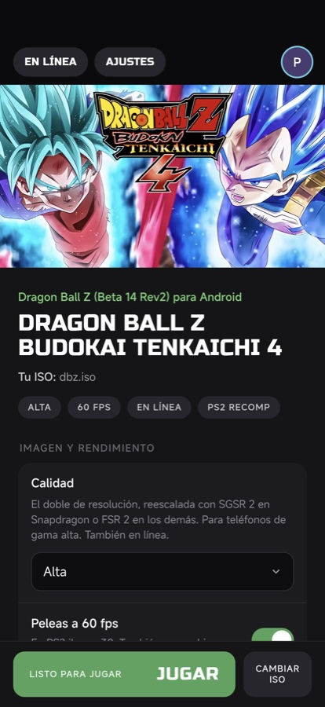
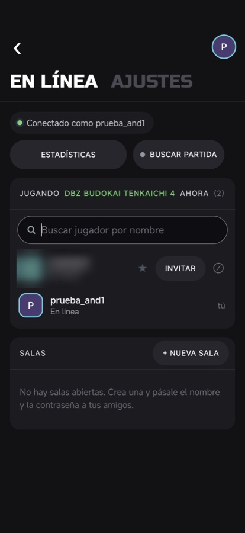
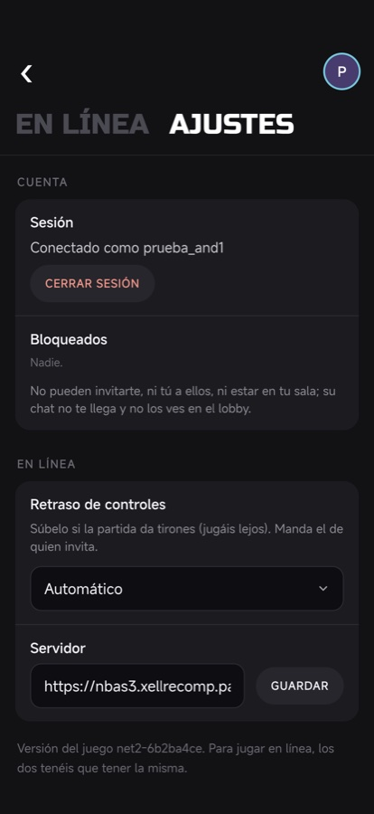
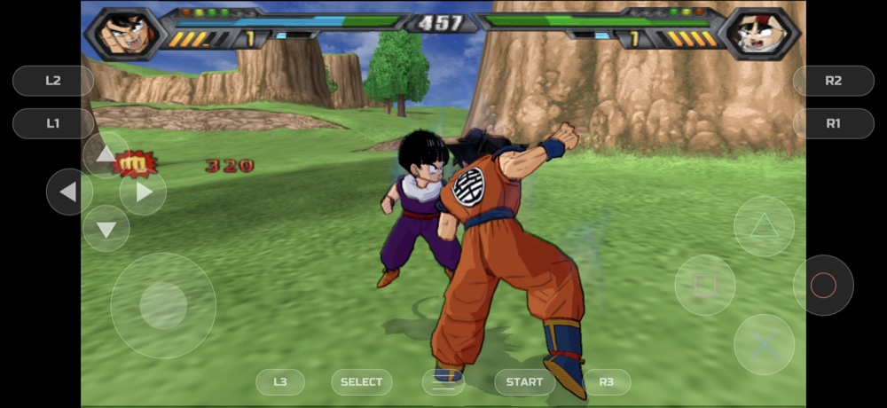

# DBZ BT4 for Android

The recompiled game on Android (arm64, Android 12+, a Vulkan driver with VK_KHR_synchronization2 -- 2022 or later; older
drivers get a message instead of a black screen): the same runtime and native renderer as the Mac build,
and the same Recomp launcher (recomp-online's Go code and frontend) in a WebView. No game data in the app: the player
picks their ISO with the system's document picker; it is read in place (a file descriptor), never copied.

The launcher in portrait (Biblioteca, En línea, Ajustes) and a fight on a POCO F8 Ultra. A real player's name in the
lobby capture is blurred.

**Download:** the signed APK is in the [Recomp for Android release](https://github.com/recomp-code/recomp-online/releases/tag/android-v3.4.7)
of recomp-online. Install it, open it, pick your ISO (SLUS-21978, DBZ BT4 Beta 14 Rev2) and play. Android 12 or later,
arm64, a 2022+ Vulkan driver.

## What is in it

- `../patches/bt3recomp-bt4mod-android.patch` - the runtime layer, on top of the Mac native tree (macos/build_runner.sh):
  - `android/android_main.cpp` - SDL_main: the launcher's environment, the log, the game's process end
  - `android/touch_pad.cpp` - on-screen controls (floating stick, D-pad, face buttons, shoulders, menu)
  - `android/gl_es_shim.cpp` - the GL 3.3 code on GLES 3.x (shader versions, dual-source blend, desktop entry points)
  - `android/perf_hint.cpp` - ADPF performance hints (the cores stayed at ~1 GHz without them)
  - `android/android_compat.h` - bionic gaps; `ps2_fiber.cpp` - an AArch64 context switch (no makecontext on Android)
  - `ps2_seamvk*.cpp` - [ahbshare] zero-copy frames to GL through AHardwareBuffers, classic descriptor sets (Adreno's
    descriptor-buffer path faults), the upscaler's output fit to a phone's screen
  - `seamvk/sgsr2_*.comp` - Snapdragon Game Super Resolution 2 (Qualcomm, BSD-3, `SGSR2-LICENSE.txt`), the 3-pass
    compute variant: the upscaler on Adreno GPUs (Vulkan vendor ID 0x5143), FSR 2 on the others and as the fallback;
    `PS2X_SEAMVK_UPSCALE=sgsr2` / `fsr2` forces one
  - `ps2_audio.cpp` / `ps2_host_audio.cpp` - deeper device buffers on a phone (the music pair four deep, the voice and
    effect streams eight) and the effects mix bounded by everything queued (~116 ms): no crackle in the menus or the
    attract demo, hits no later than before
  - `ps2_runtime.cpp` - [pinthreads] the guest thread on the fastest core cluster, the GL thread off the slowest
  - `android/perf_hint.cpp` - [thermal] the phone's thermal headroom caps the upscaler before the system throttles
- `../patches/bt3recomp-bt4mod-detmath.patch` - shared (every platform): the game's sin/cos kernels and `acosf` from
  portable code; the host libms disagree in the last bit and online fights drifted apart
- `project/` - the app: `LauncherActivity` (WebView + `RecompBridge`, JNI into liblauncher.so), `GameActivity` (SDL's
  activity around libmain.so, process `:game`), `GameService` (keeps the online session alive while playing)
- `android_bridge.js` / `android.css` - the frontend's Wails runtime and its phone layout

## Building

    ./build_ffmpeg.sh                 # once: static FFmpeg for arm64
    ./build_runner.sh plain           # libmain.so (or gen -> train on a phone -> use, for PGO)
    ./make_apk.sh debug               # or: source <keys>/release.env; ./make_apk.sh release

`build_runner.sh` builds `BT3MOD` (default `~/NBAStreetRecomp/bt3mod-android`: the Mac native tree plus the Android
patch). Outputs go to `ANDROID_WORK` (default `~/NBAStreetRecomp/android`). Needs the NDK 28, Gradle's JDK 21 and Go.

PGO: `build_runner.sh gen`, install that build, run the game with `PS2X_PGO_WRITE_AT=150` (an autostart fight in the
60 fps mode: `PS2X_AUTOSTART=1 PS2X_NO_GAMEPAD=1 PS2X_FPS60=1`), `adb pull` the `pgo-*.profraw` from the app's external
files dir into `$ANDROID_WORK/pgo/`, then `build_runner.sh use`.

Debug builds also read `env.txt` (KEY=VALUE lines) from the app's external files dir when the launcher starts the
game -- for diagnostics; leave it empty for normal play. Debug builds start the game directly too (`adb shell am start -n io.github.recompcode.dbzbt4/.GameActivity`), with
`env.txt` (KEY=VALUE lines) and the disc files in `/sdcard/Android/data/io.github.recompcode.dbzbt4/files`.

## Measured

### POCO F8 Ultra (Snapdragon 8 Elite Gen 5, Adreno 840, 2608x1200, "Alta": 2x render + FSR 2 to 2187x1006)

60 fps fight: game 59-60 fps, window 60, p95 17.7 ms, 6.8 ms of guest CPU per frame. Without the game category the
system kept the cores at ~1 GHz (25 ms per frame); without ADPF the same; without the AHardwareBuffer path the CPU
copy of the frame took the window down to ~30 fps at that resolution.

### Pixel 7a (Tensor G2, Mali-G710, 1080x2400, "Equilibrada")

Mali has no shaderClipDistance: its shader compiler faulted on the seam's gl_ClipDistance writes -> [noclip] variants
(seam_noclip / seam_mv_noclip, glslc -DSEAM_NO_CLIPDIST). CPU-bound and quick to heat: skin throttling starts at 39 C,
and after a few minutes of fights while charging it reaches the severe state (cores at 0.5-1.6 GHz), 23-28 fps in the
60 fps mode. Dynamic resolution steps the FSR 2 output down there and back up when that does not help (CPU-bound).

### Mi Note 10 Lite (Snapdragon 730G, Adreno 618, driver from 2021, Vulkan 1.1)

Not supported: no VK_KHR_synchronization2, timeline semaphores or descriptor indexing (Granite's core); the GL renderer
runs but falls under 1 fps in a fight. The game says so and exits.

Thread pinning (same phone, an autostart 60 fps fight): unpinned the guest took 10.5-13 ms per frame and the two GS
threads 37-44 % of a core each; with the guest thread on the 4.6 GHz pair, 6-8 ms and 11-15 %, window p95 17.6 ms either
way.

## Online

Android plays online through the same server and lobby as the PC and Mac versions (`GameService` keeps the session
alive). Lockstep needs two identical simulations, and they are: replaying the same recorded inputs (`PS2X_INREC` on one
machine, `PS2X_INPLAY` on both), a POCO F8 Ultra (-O2 + PGO) and a Mac (-O1 + PGO) stay bit-identical through 19840
frames with fights (1972 of 1972 state hashes). It took three fixes: the game's environment set before `libmain.so`
loads (the runtime reads it in static initializers; Android ran online without frame stepping), and the `detmath` layer:
the recompiler had handed the game's `__kernel_sinf` / `__kernel_cosf` (and the HLE'd `acosf`) to the host's libm, whose
results differ in the last bit between Apple, bionic and MSVC. Confirmed live: a POCO
against a Mac (both with `detmath`) fought online for 19680 frames, 0 desyncs, 328 of 328 hashes equal. The launcher's
online protocol is `net3` for builds with `detmath`: the PC and Mac releases join Android once they carry it; until then
the lobby shows them as another version of the game. Online the effects keep a 23-92 ms lead over the device (stepped
mode mixes exactly what each frame is due; with no lead any late frame cut the sound).

## Other knobs

- generated code at -O2 on Android (build_runner.sh): with PGO, 7.6 -> 7.1 ms of guest CPU per frame (A/B, emulator)
- ADPF holds every GameThread / GsThread / PS2Thread and the SDL main thread; PS2X_ADPF=0 turns it off
- [dynres] PS2X_DYNRES=0 turns the dynamic upscaler output off; PS2X_UPSCALE_MPX=<n> fixes the budget
- [pinthreads] PS2X_PIN=0 turns the core pinning off; [thermal] PS2X_THERMAL=0 the thermal cap; PS2X_SNDDIAG=1 logs audio underruns
